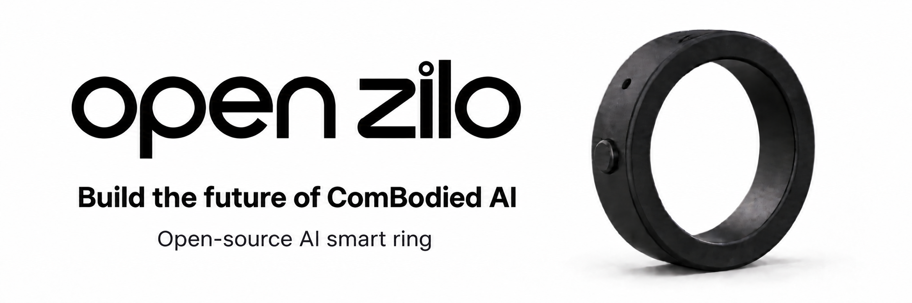
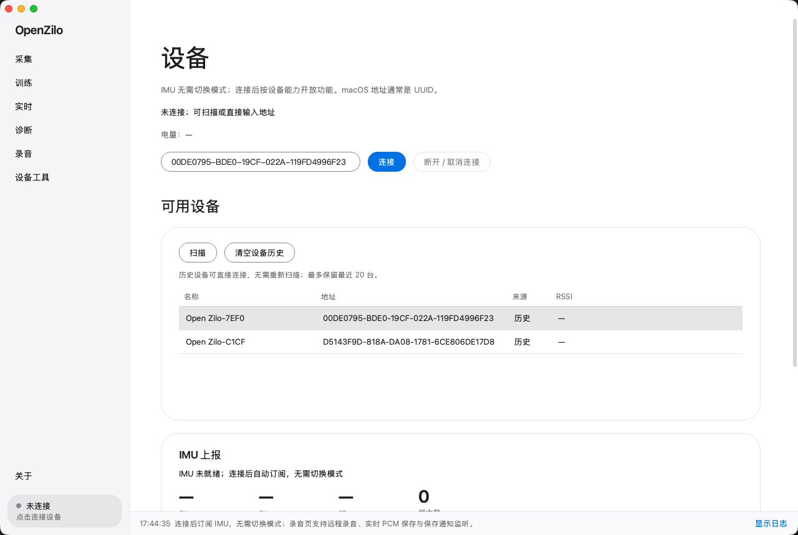
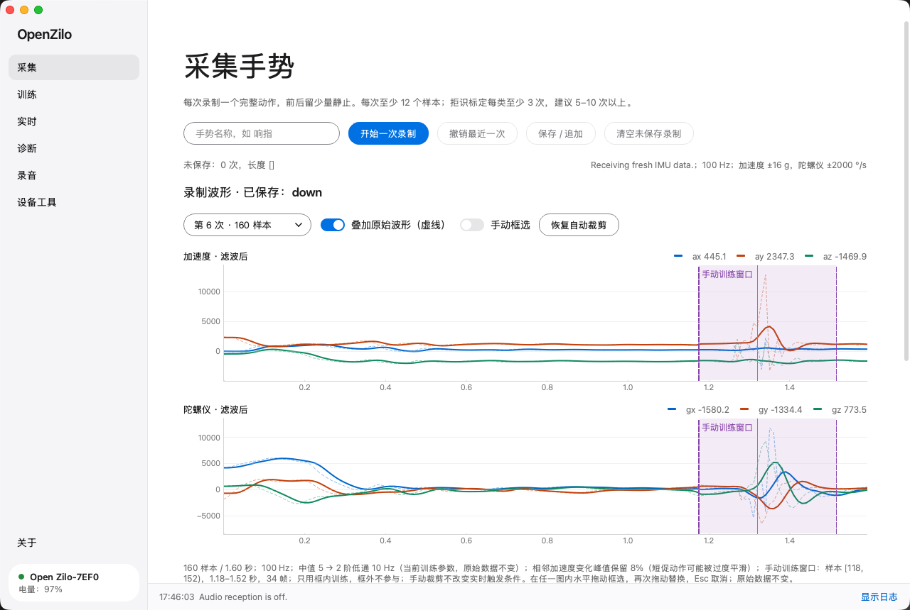
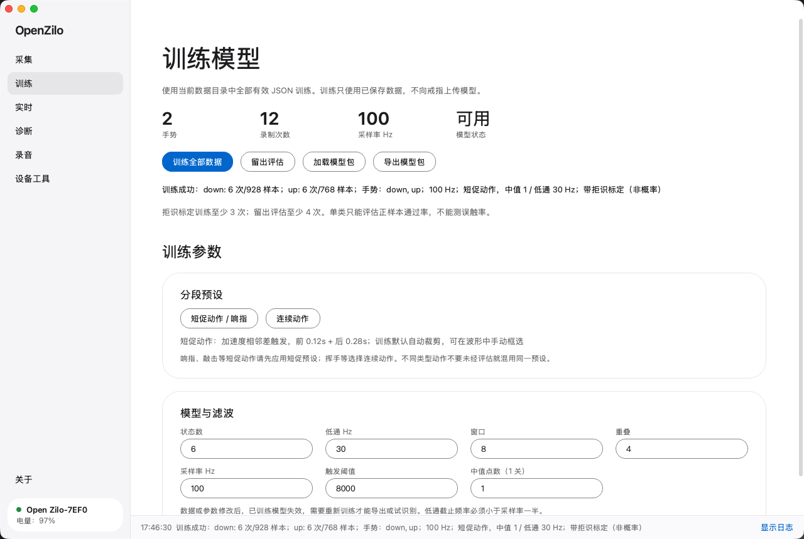
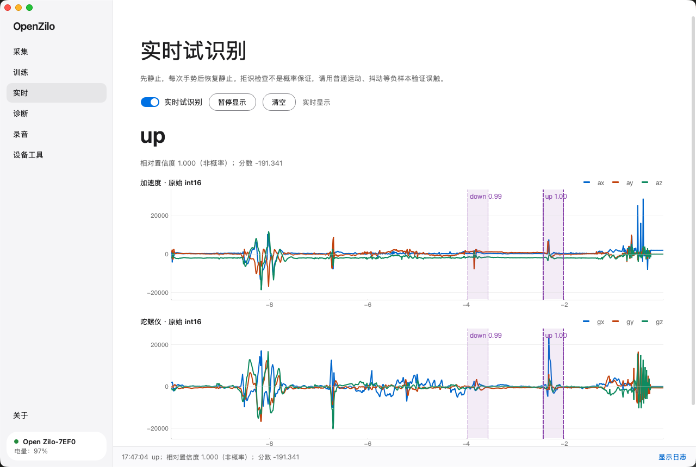
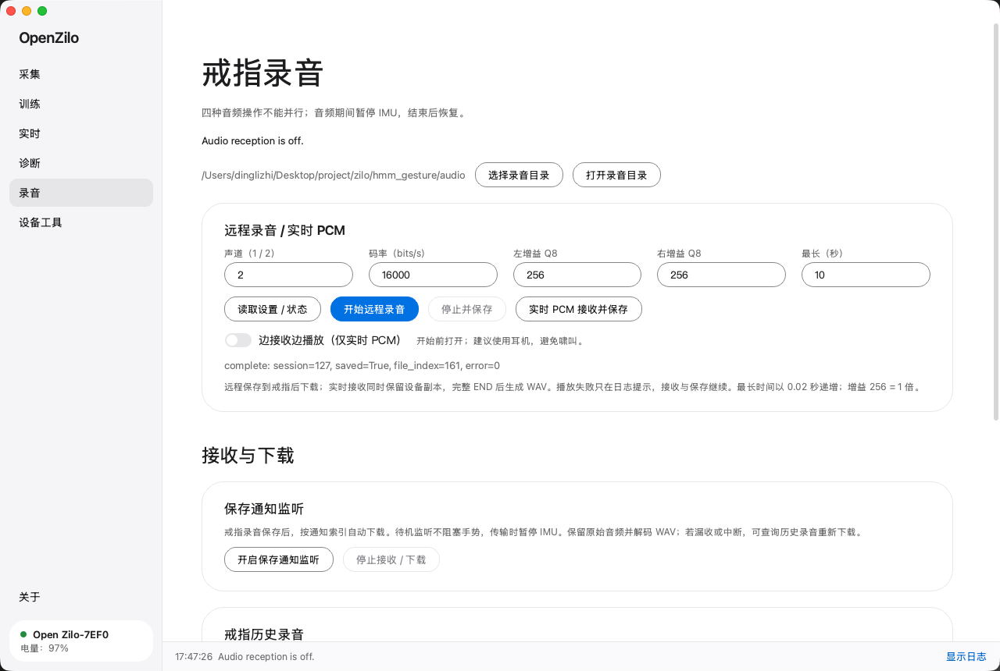
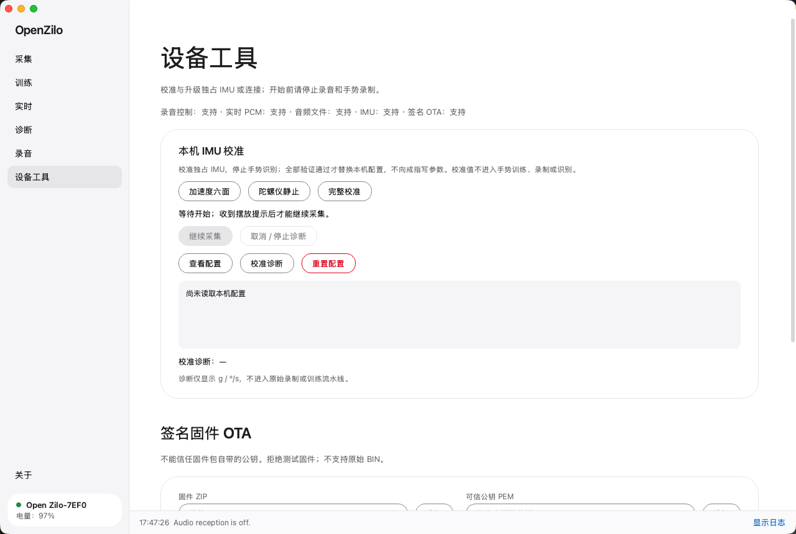
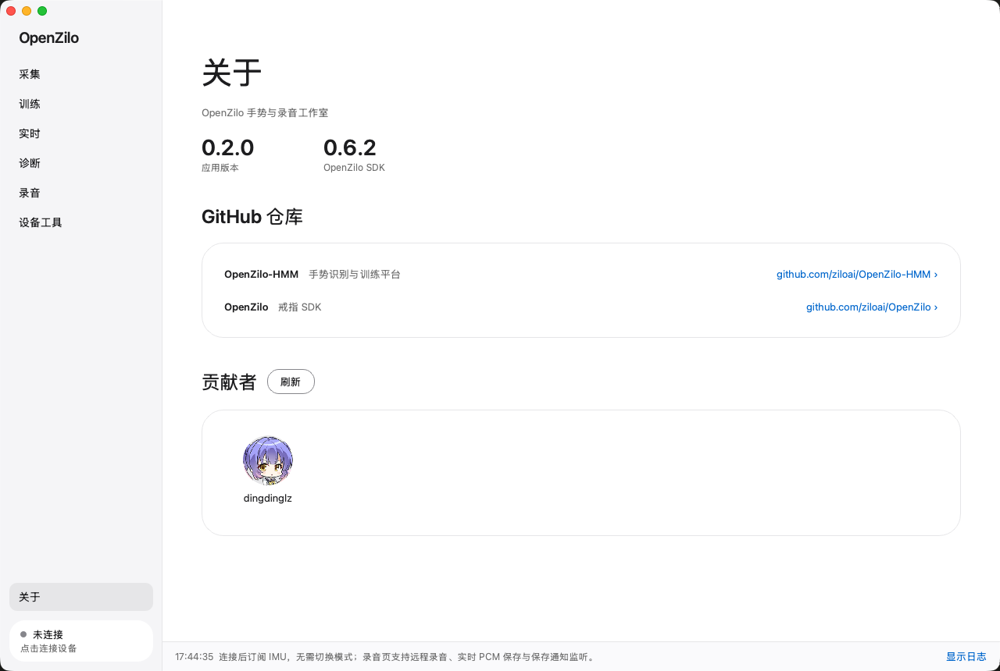
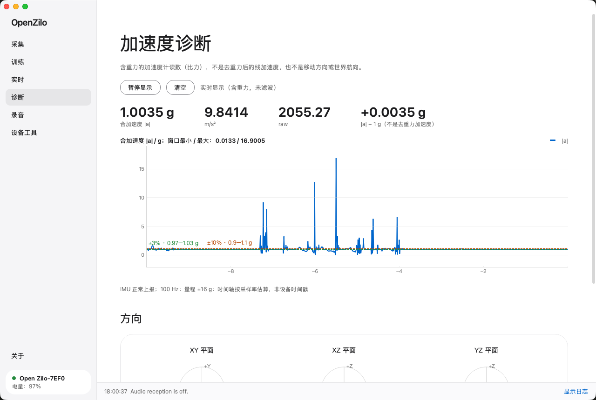

<p align="center">
  <a href="https://openzilo.com"></a>
</p>

<h1 align="center">OpenZilo Gesture Studio & Python Recognition</h1>

<p align="center">Teach an OpenZilo ring your own gestures, then recognize them in your Python app.</p>

<p align="center">
  <a href="README.zh-CN.md">中文</a> · <a href="#quick-start">Quick start</a> ·
  <a href="#workflow">Workflow</a> · <a href="#use-it-in-python">Python API</a> ·
  <a href="#documentation">Docs</a>
</p>

Record a few repetitions of a gesture in the desktop app, train a model, and export it as a single file that your Python code can load.

**Record → Train → Test live → Export `*.gesture.json` → Recognize in Python**

Training and recognition run on your computer. Nothing is flashed or uploaded to the ring.

| Package | What it does | Needs |
| --- | --- | --- |
| `hmm-gesture-studio` | Desktop app for connecting, recording, training and testing, plus ring audio and device tools | OpenZilo SDK, PySide6, Bluetooth |
| `hmm-gesture` | Loads an exported model and recognizes gestures | NumPy, SciPy and hmmlearn only |

## Quick start

You need [uv](https://docs.astral.sh/uv/getting-started/installation/), Git and a desktop session. Both packages support Python 3.10+.

```bash
git clone https://github.com/ziloai/OpenZilo-HMM.git
cd OpenZilo-HMM
uv sync --locked --all-packages
uv run --locked --all-packages hmm-gesture-studio
```

The Studio interface is in Chinese, so the steps below give each label with a translation.

**No ring yet?** Train on the included sample data, which has six gestures with five repetitions each at 25 Hz:

```bash
uv run --locked --package hmm-gesture-studio hmm-gesture-train --data sample_data --output exports/demo.gesture.json
uv run --locked python examples/recognize_export.py --bundle exports/demo.gesture.json --input "sample_data/向上.json"
```

This classifies the recordings it was trained on, so it shows that the pipeline works, not how accurate it is.

<details>
<summary>Platform requirements</summary>

- **Bluetooth:** a working adapter and permission to use it (BlueZ on Linux; allow your terminal or IDE on macOS).
- **Linux Qt libraries:** if Qt reports a missing library, run `sudo apt install libegl1 libgl1 libxkbcommon0 libdbus-1-3`.
- **Audio:** decoding audio files from the ring to WAV needs a system `ffmpeg`. Without it, the raw `.bin` is still saved. Gestures don't need it.
- **Firmware:** the enhanced feature baseline is `V2.001.0002.0001`. Studio enables features based on what the connected ring reports.

</details>

## Workflow

### 1. Connect the ring

Scan and select your ring, or enter its address, then click 连接 (Connect). Rings you've connected to are remembered. Recording becomes available once fresh motion data arrives, and no gesture mode needs to be turned on.



### 2. Record a gesture

Enter a name, click 开始一次录制 (Start a take), perform the gesture once, then stop. Record at least 3 takes, ideally 5–10 or more, then click 保存 / 追加 (Save / Append).

Each take shows its waveform. If automatic cropping misses the gesture, turn on 手动框选 (Manual selection) and drag across the chart to mark it. This only adds an annotation; the raw recording is unchanged.

The same page imports existing JSON and CSV recordings and deletes saved gestures.



### 3. Train

Choose the preset that fits the gesture, then click 训练全部数据 (Train on all data):

- **短促动作 / 响指 (Short / Snap):** snaps, taps and other brief impacts
- **连续动作 (Continuous):** waves and other longer movements

With at least 4 takes per gesture, 留出评估 (Hold-out evaluation) tests on recordings left out of training. Changing the data or settings invalidates the model, so retrain afterwards.



### 4. Test it live

Turn on 实时试识别 (Live recognition). Start at rest and return to rest between gestures. Each recognized gesture is outlined on the chart with its name and confidence.

Also try everyday movements to see what triggers by mistake. Training only sees examples of your gestures, so it can't guarantee that other movements are rejected.



### 5. Export

On the training page, click 导出模型包 (Export model) to save a `*.gesture.json` file. It contains the gesture names, model parameters, and the filtering and segmentation settings, so your application doesn't have to reconfigure them.

## Other Studio tools

<table>
  <tr>
    <td width="50%" valign="top">
      <br>
      <b>录音 (Audio)</b><br>
      Record remotely, stream live PCM with optional monitoring, auto-download recordings made with the ring's button, or fetch them from its history.
    </td>
    <td width="50%" valign="top">
      <br>
      <b>设备工具 (Device tools)</b><br>
      Run guided IMU calibration and signed firmware updates. Calibration stays on your computer and never affects gesture data. A firmware update requires a separately trusted public key, and 100% sent doesn't mean it's installed.
    </td>
  </tr>
  <tr>
    <td valign="top">
      <br>
      <b>关于 (About)</b><br>
      Shows versions, repositories and contributors. Opening this page is the only time the app contacts GitHub, and it sends no device or gesture data.
    </td>
    <td valign="top">
      <br>
      <b>诊断 (Diagnostics)</b><br>
      Shows acceleration magnitude and direction in real time. Readings <b>include gravity</b>, so they don't show movement direction. See <a href="studio/README.md#加速度方向与合加速度诊断">how they're calculated</a>.
    </td>
  </tr>
</table>

## Use it in Python

Add the recognition package to your project. It doesn't install Studio, Qt or the Bluetooth SDK:

```bash
uv add /path/to/OpenZilo-HMM
```

Classify one complete gesture, where `samples` is an `(N, 6)` array:

```python
from hmm_gesture import GestureRecognizer

recognizer = GestureRecognizer.load("demo.gesture.json")
print(recognizer.gesture_names, recognizer.sample_rate_hz)

result = recognizer.predict(samples, sample_rate_hz=25)
if result is not None:  # None means too short or rejected
    print(result.name, result.confidence, result.score)
```

Or feed a continuous stream from any source, such as the SDK, a serial port, a network or files:

```python
for result in recognizer.feed(batch, sample_rate_hz=25):  # may return several gestures
    print(result.name, result.confidence)

recognizer.reset()  # after a reconnect or repositioning the ring
```

### Before you rely on the results

- **Input format:** columns are `ax, ay, az, gx, gy, gz` in raw int16 units, not g or °/s.
- **Match training conditions:** `sample_rate_hz` only checks the rate; it doesn't resample or configure the ring. Keep the sample rate, sensor range and how the ring is worn the same as in training.
- **Confidence isn't a probability:** it's a relative score, and it's `None` for single-gesture models.
- **Single-gesture models:** `feed()` raises an error unless the model has rejection calibration, which needs at least 3 takes when training.
- **Measuring accuracy:** use recordings from a separate session, and include movements that aren't your gestures.
- **One recognizer per stream:** recognizers keep state, so don't share one across threads or devices.

## Documentation

| Topic | Document |
| --- | --- |
| Studio details: short gestures, rejection, audio, calibration, firmware updates (Chinese) | [studio/README.md](studio/README.md) |
| Full API and export format (Chinese) | [docs/architecture.md](docs/architecture.md) |
| SDK integration and firmware contract | [docs/sdk.md](docs/sdk.md) |

## Older tools

- **Tkinter interface:** `uv run --locked --all-packages hmm-gesture-studio --ui legacy`. This requires a Python with Tkinter.
- **Scripts:** `record_gesture.py`, `train_hmm.py` and `recognize.py` still work. They use `.pkl` models, which Studio and `hmm-gesture` don't import, so retrain from your JSON recordings to get a `*.gesture.json`. **Only load pickle files you trust**, because loading one can run code. `record_gesture.py` overwrites recordings with the same name.

## Development

```bash
uv run --locked --all-packages python -m unittest discover -s tests -v
uv build --all-packages --wheel
```

Commit `uv.lock` along with any dependency change. Tests don't use real Bluetooth hardware, so check device behavior on a real ring. Report problems in [GitHub Issues](https://github.com/ziloai/OpenZilo-HMM/issues).

## License

[MPL-2.0](LICENSE), covering the software, documentation, sample data, pretrained models and bundled assets. See [NOTICE.md](NOTICE.md) for dependencies and trademarks.
