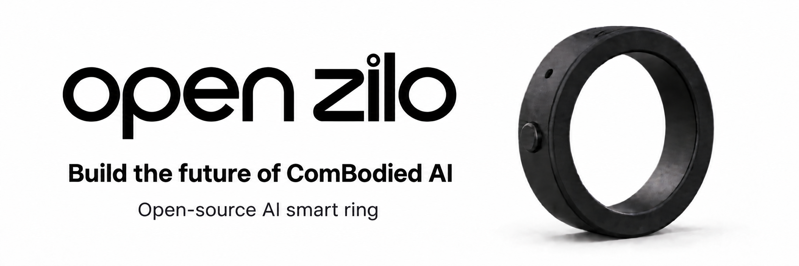
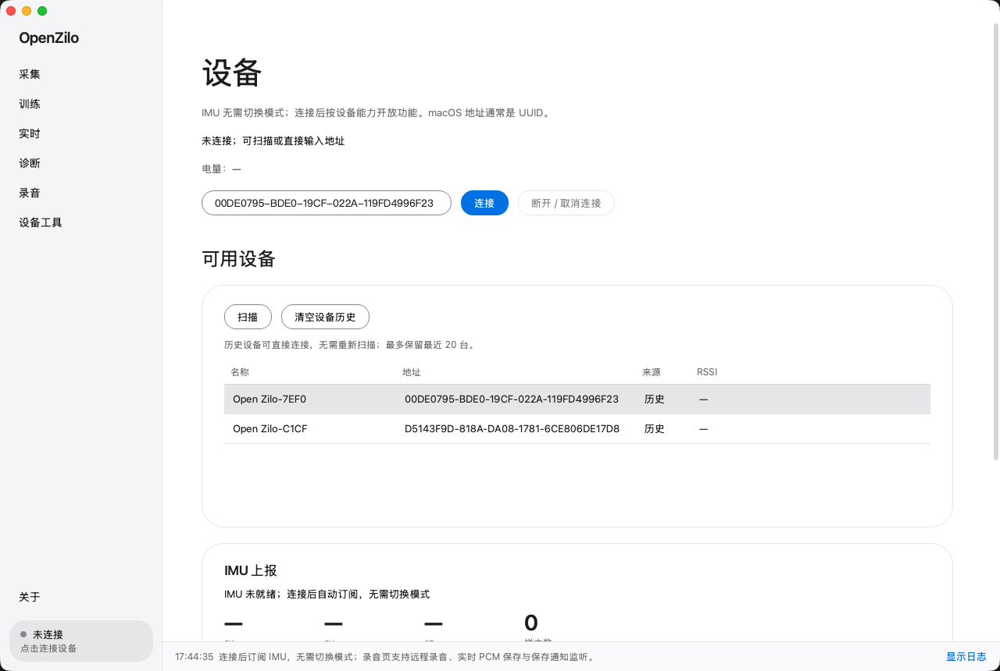
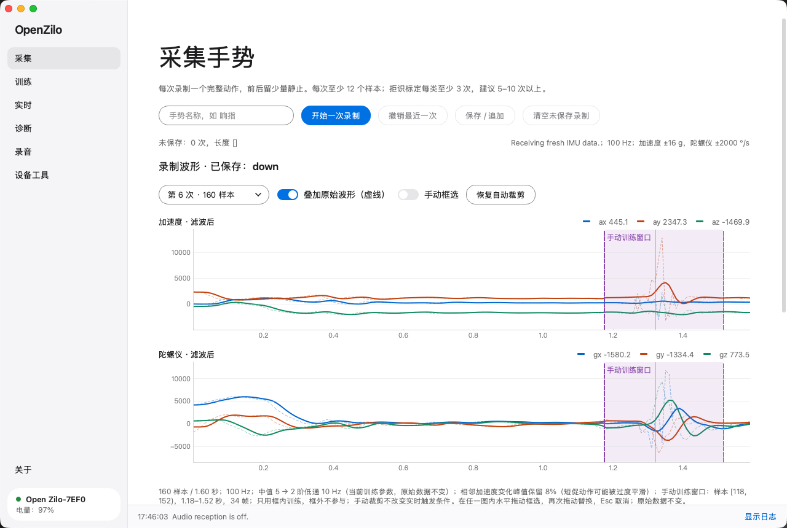
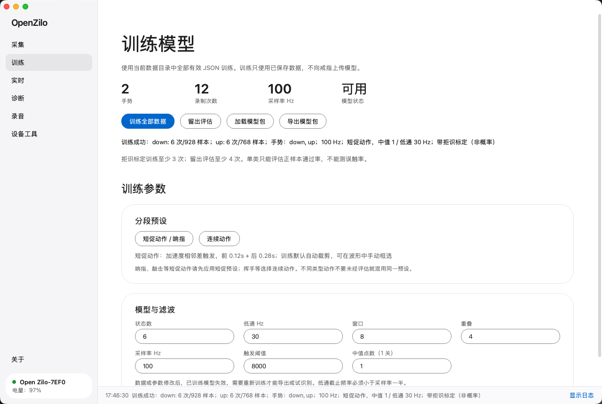
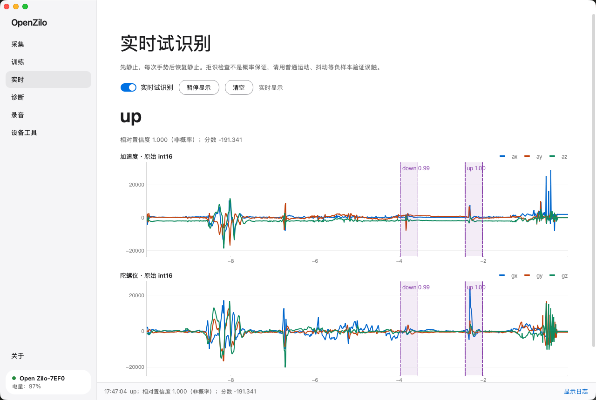
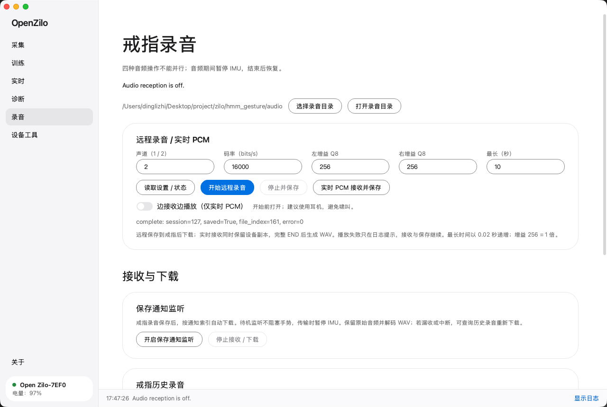
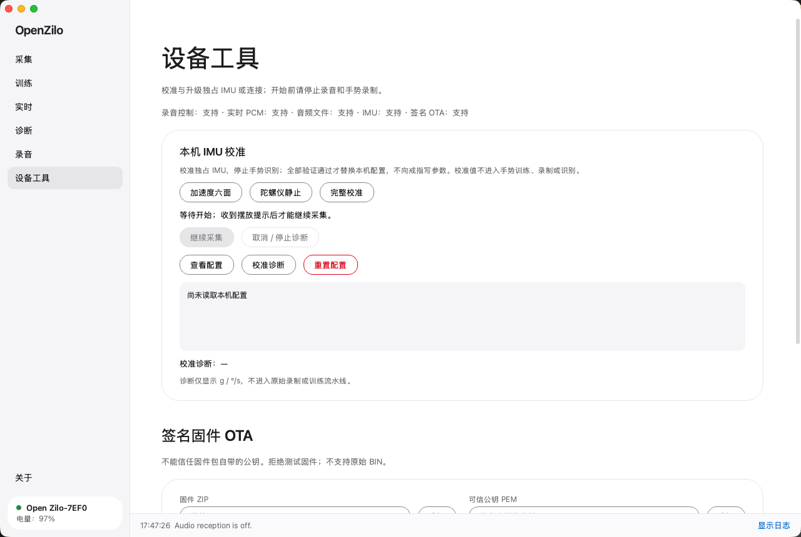
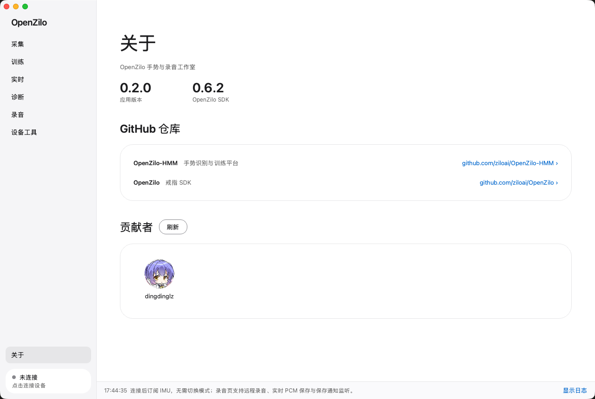
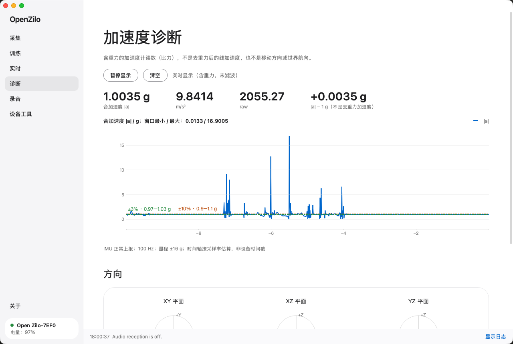

<p align="center">
  <a href="https://openzilo.com"></a>
</p>

<h1 align="center">OpenZilo 手势训练平台与 Python 识别包</h1>

<p align="center">让 OpenZilo 戒指学会你的手势，并在自己的 Python 程序里识别它们。</p>

<p align="center">
  <a href="README.md">English</a> · <a href="#快速开始">快速开始</a> ·
  <a href="#使用流程">使用流程</a> · <a href="#在-python-中使用">Python API</a> ·
  <a href="#文档">文档</a>
</p>

在桌面应用里把手势录几遍，训练出模型，再导出成一个文件，Python 代码加载它就能识别。

**录制 → 训练 → 实时试识别 → 导出 `*.gesture.json` → 在 Python 中识别**

训练和识别都在电脑上运行，不刷固件，也不向戒指上传模型。

| 发行包 | 用途 | 依赖 |
| --- | --- | --- |
| `hmm-gesture-studio` | 桌面应用：连接、录制、训练、试识别，以及戒指录音和设备工具 | OpenZilo SDK、PySide6、蓝牙 |
| `hmm-gesture` | 加载导出的模型并识别手势 | 仅 NumPy、SciPy、hmmlearn |

## 快速开始

需要 [uv](https://docs.astral.sh/uv/getting-started/installation/)、Git 和图形桌面环境。两个包都支持 Python 3.10+。

```bash
git clone https://github.com/ziloai/OpenZilo-HMM.git
cd OpenZilo-HMM
uv sync --locked --all-packages
uv run --locked --all-packages hmm-gesture-studio
```

**手边没有戒指？** 可以用仓库自带的示例数据训练，共六类手势，每类五次，采样率 25 Hz：

```bash
uv run --locked --package hmm-gesture-studio hmm-gesture-train --data sample_data --output exports/demo.gesture.json
uv run --locked python examples/recognize_export.py --bundle exports/demo.gesture.json --input "sample_data/向上.json"
```

这里识别的是训练用过的数据，只能说明流程跑得通，不代表准确率。

<details>
<summary>运行环境要求</summary>

- **蓝牙：** 需要可用的适配器和蓝牙权限（Linux 使用 BlueZ；macOS 需允许终端或 IDE 使用蓝牙）。
- **Linux 的 Qt 系统库：** 如果提示缺少系统库，运行 `sudo apt install libegl1 libgl1 libxkbcommon0 libdbus-1-3`。
- **音频：** 把戒指上的录音文件解码成 WAV 需要系统安装 `ffmpeg`；没有安装时仍会保存原始 `.bin`。手势功能不需要它。
- **固件：** 增强功能的固件基线是 `V2.001.0002.0001`。Studio 按连接的戒指上报的能力开放功能。

</details>

## 使用流程

### 1. 连接戒指

扫描并选择戒指，或者直接输入地址，再点“连接”。连接过的戒指会被记住。收到新的运动数据后才能开始录制，不需要切换手势模式。



### 2. 录制手势

输入名称，点“开始一次录制”，做一次动作后停止。每类至少录 3 次，建议 5–10 次以上，然后点“保存 / 追加”。

每次录制后都会显示波形。如果自动裁剪没框住动作，可以打开“手动框选”，在图上横向拖动来标记。这只是添加标注，不改变原始录制。

导入已有的 JSON、CSV 录制和删除已保存的手势也在这一页。



### 3. 训练

按手势类型选择预设，再点“训练全部数据”：

- **短促动作 / 响指：** 响指、敲击等短暂的冲击
- **连续动作：** 挥手等持续时间较长的动作

每类至少有 4 次录制时，可以用“留出评估”在未参与训练的录制上测试。数据或参数改变后，模型会失效，需要重新训练。



### 4. 实时试识别

打开“实时试识别”。先保持静止，每次手势后也恢复静止。识别到的手势会在图上框出，并标注名称和置信度。

也要做些日常动作，看看哪些会误触发。训练只见过你的手势样本，不能保证其他动作都被拒识。



### 5. 导出

在训练页点“导出模型包”，保存为 `*.gesture.json`。文件里包含手势名称、模型参数以及滤波和分段设置，应用端无需重新配置。

## Studio 的其他工具

<table>
  <tr>
    <td width="50%" valign="top">
      <br>
      <b>录音</b><br>
      远程录音，实时接收 PCM 并可选边收边听，自动下载用戒指按键录制的音频，或从戒指历史记录下载。
    </td>
    <td width="50%" valign="top">
      <br>
      <b>设备工具</b><br>
      引导式 IMU 校准和签名固件升级。校准结果只保存在电脑上，不影响手势数据。固件升级需要另行取得可信公钥；发送到 100% 不代表已安装成功。
    </td>
  </tr>
  <tr>
    <td valign="top">
      <br>
      <b>关于</b><br>
      显示版本、仓库和贡献者。应用只在打开这一页时访问 GitHub，不发送设备或手势数据。
    </td>
    <td valign="top">
      <br>
      <b>诊断</b><br>
      实时显示合加速度的大小和方向。读数<b>包含重力</b>，不代表移动方向。详见<a href="studio/README.md#加速度方向与合加速度诊断">计算方式</a>。
    </td>
  </tr>
</table>

## 在 Python 中使用

把识别包添加到你的项目。它不会安装 Studio、Qt 或蓝牙 SDK：

```bash
uv add /path/to/OpenZilo-HMM
```

识别一次完整的手势，其中 `samples` 是 `(N, 6)` 的数组：

```python
from hmm_gesture import GestureRecognizer

recognizer = GestureRecognizer.load("demo.gesture.json")
print(recognizer.gesture_names, recognizer.sample_rate_hz)

result = recognizer.predict(samples, sample_rate_hz=25)
if result is not None:  # None 表示数据过短或被拒识
    print(result.name, result.confidence, result.score)
```

也可以输入来自任意来源的连续数据，例如 SDK、串口、网络或文件：

```python
for result in recognizer.feed(batch, sample_rate_hz=25):  # 一批数据可能返回多个手势
    print(result.name, result.confidence)

recognizer.reset()  # 断线重连或重新佩戴后调用
```

### 使用识别结果前请注意

- **输入格式：** 列顺序为 `ax, ay, az, gx, gy, gz`，单位是原始 int16，不是 g 或 °/s。
- **与训练条件保持一致：** `sample_rate_hz` 只用于检查，不会重采样，也不会配置戒指。采样率、量程和佩戴方式都要与训练时相同。
- **置信度不是概率：** 它只是相对分数，单类模型的置信度为 `None`。
- **单类模型：** 没有拒识标定时调用 `feed()` 会报错；训练时至少需要 3 次录制才能标定。
- **评估准确率：** 使用另一次会话的录制，并加入不属于这些手势的动作。
- **一条数据流一个识别器：** 识别器有内部状态，不要在多个线程或设备间共用。

## 文档

| 主题 | 文档 |
| --- | --- |
| Studio 详解：短促动作、拒识、录音、校准、固件升级 | [studio/README.md](studio/README.md) |
| 完整 API 与导出格式 | [docs/architecture.md](docs/architecture.md) |
| SDK 接入与固件契约 | [docs/sdk.md](docs/sdk.md) |

## 旧版工具

- **Tkinter 界面：** `uv run --locked --all-packages hmm-gesture-studio --ui legacy`，需要带 Tkinter 的 Python。
- **命令行脚本：** `record_gesture.py`、`train_hmm.py`、`recognize.py` 仍可使用。它们使用 `.pkl` 模型，Studio 和 `hmm-gesture` 不导入这种格式；要得到 `*.gesture.json`，请用 JSON 录制重新训练。**只加载可信的 pickle 文件**，因为加载时可能执行代码。`record_gesture.py` 会覆盖同名录制。

## 开发

```bash
uv run --locked --all-packages python -m unittest discover -s tests -v
uv build --all-packages --wheel
```

修改依赖时，请同时提交 `uv.lock`。测试不使用真实蓝牙硬件，设备行为需要在真实戒指上验证。问题反馈请到 [GitHub Issues](https://github.com/ziloai/OpenZilo-HMM/issues)。

## 许可证

采用 [MPL-2.0](LICENSE)，涵盖软件、文档、示例数据、预训练模型和随附素材。依赖和商标说明见 [NOTICE.md](NOTICE.md)。
